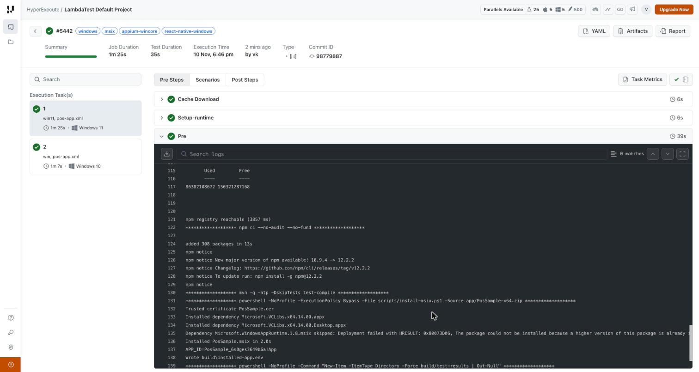
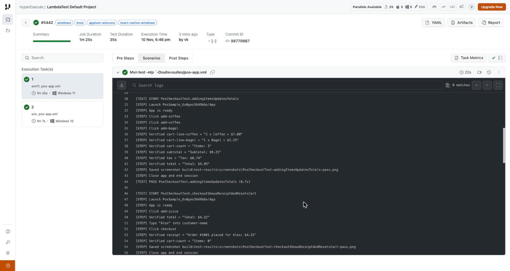
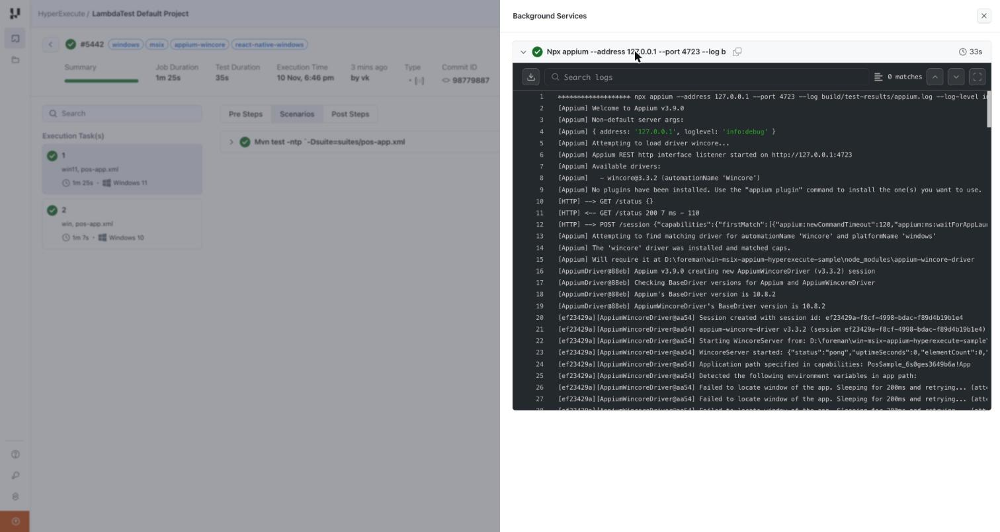
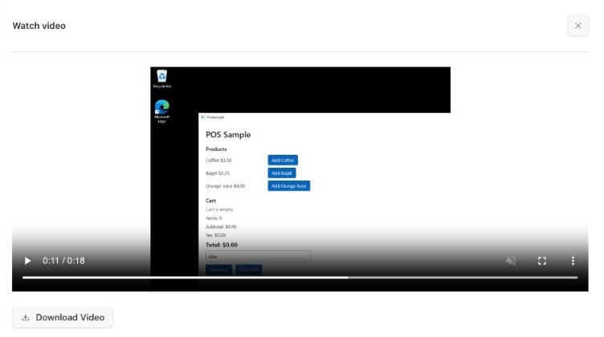
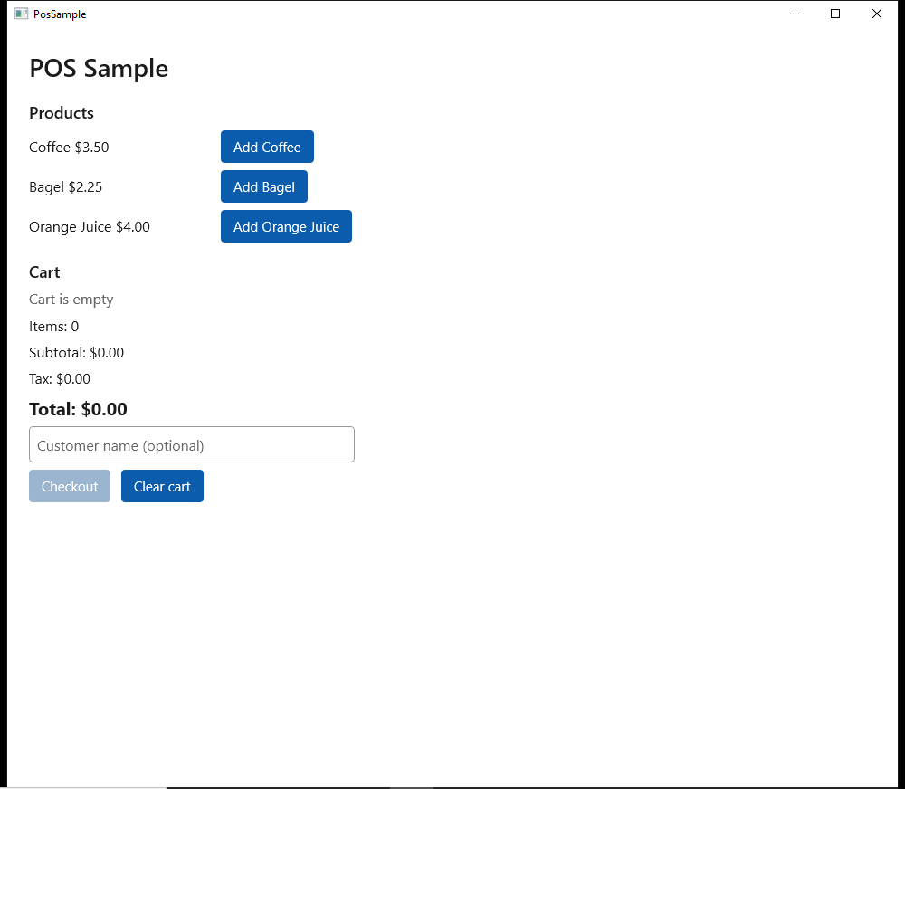
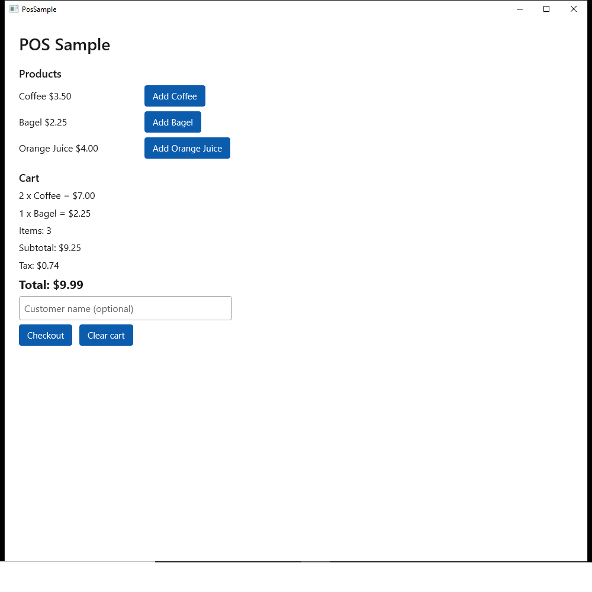
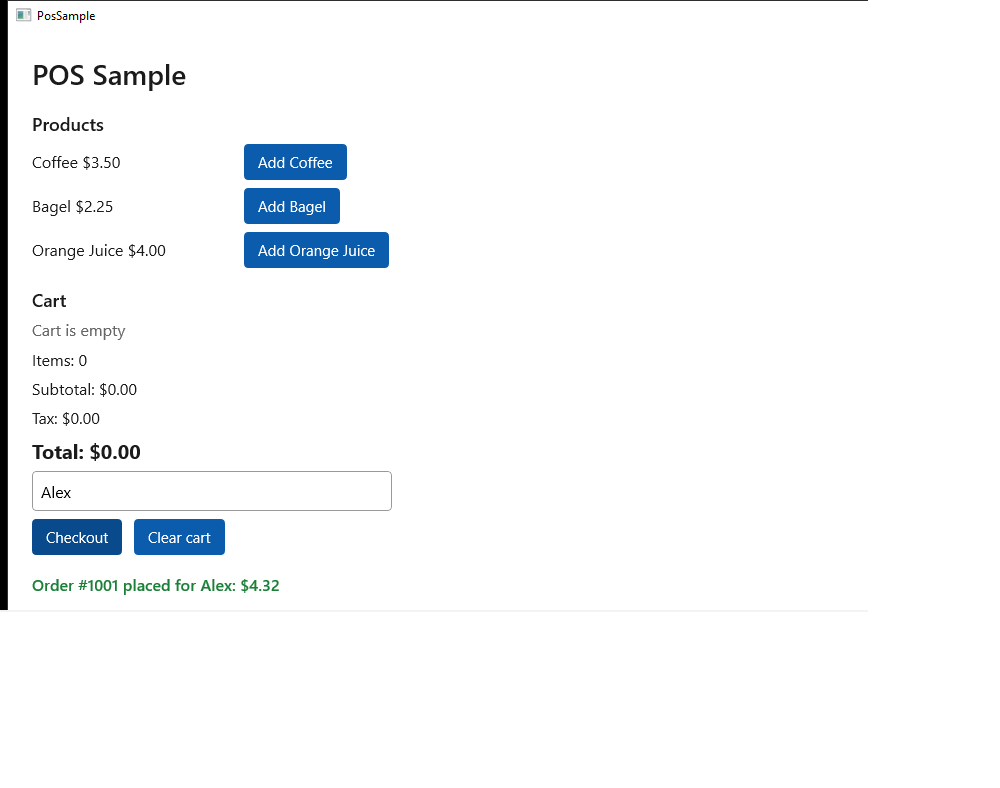

# Automating a Windows MSIX app on HyperExecute

This repo is a working example of **testing a Windows desktop app packaged as an MSIX on
[HyperExecute](https://www.testmuai.com/support/docs/getting-started-with-hyperexecute/)**. The app is built with
[React Native for Windows](https://microsoft.github.io/react-native-windows/), and the tests use Java + TestNG + Appium with the
[`appium-wincore-driver`](https://github.com/appium/appium-wincore-driver) (automationName `Wincore`). It passes end to
end on HyperExecute's **Windows 11** and **Windows Server 2022** runners.

In one job, HyperExecute:

1. downloads a prebuilt, signed MSIX and sideloads it (certificate, framework dependencies, app),
2. starts an Appium server with the WinCore driver in the background on the runner,
3. runs the TestNG tests against the real app window,
4. uploads screenshots, the Appium log and the TestNG reports as artifacts.

```
 GitHub Actions (your CI)          HyperExecute (per OS, in parallel)
 ────────────────────────          ────────────────────────────────────────────────────────────────────────────
 npm ci                            pre                               background            testSuites
 init-windows (RNW C++ app)        ───────────────────────────────   ───────────────────   ─────────────────────
 msbuild → signed .msix   ──zip──► npm ci   (Appium + wincore)       npx appium       ◄──  mvn test
 GitHub release asset              mvn test-compile                  on 127.0.0.1:4723     -Dsuite=pos-app.xml
                                   install-msix.ps1:
                                     trust .cer → deps → Add-AppxPackage                  artifacts: screenshots/,
                                     write APP_ID (AUMID)                                  appium.log, surefire-reports/
```

The app **source never goes to HyperExecute**. It is built in CI; the job only receives the tests and
downloads the finished MSIX (`pos-app/` is listed in [`.hyperexecuteignore`](.hyperexecuteignore)).

**HyperExecute docs used in this repo:**
[Getting started](https://www.testmuai.com/support/docs/getting-started-with-hyperexecute/) ·
[CLI](https://www.testmuai.com/support/docs/hyperexecute-cli-run-tests-on-hyperexecute-grid/) ·
[YAML reference](https://www.testmuai.com/support/docs/deep-dive-into-hyperexecute-yaml/) ·
[Matrix strategy](https://www.testmuai.com/support/docs/hyperexecute-matrix-multiplexing-strategy/) ·
[Background services](https://www.testmuai.com/support/docs/hyperexecute-background-services/) ·
[Caching](https://www.testmuai.com/support/docs/hyperexecute-how-smart-caching-boosts-tests-speed/) ·
[Artifacts](https://www.testmuai.com/support/docs/hyperexecute-artifacts/) ·
[GitHub Actions](https://www.testmuai.com/support/docs/github-actions-with-hyperexecute/)

---

## What this repo shows

| | |
|---|---|
| **App under test** | `PosSample`: a small point-of-sale screen in [`pos-app/`](pos-app/), React Native for Windows 0.84 (C++ app template, new architecture), packaged as a signed x64 MSIX |
| **App delivery** | Built and signed in GitHub Actions ([`build-app.yml`](.github/workflows/build-app.yml)), published as the `app-latest` release, downloaded and sideloaded in `pre` by [`install-msix.ps1`](scripts/install-msix.ps1) |
| **Automation** | Appium 3.9 + `appium-wincore-driver` 3.3.2 (UI Automation, no WinAppDriver), Java client 10, TestNG 7 |
| **HyperExecute features** | [`runson`](https://www.testmuai.com/support/docs/deep-dive-into-hyperexecute-yaml/#runson) from a [matrix](https://www.testmuai.com/support/docs/hyperexecute-matrix-multiplexing-strategy/) (`win11` and `win` in parallel), [`background`](https://www.testmuai.com/support/docs/hyperexecute-background-services/) service, [`runtime`](https://www.testmuai.com/support/docs/deep-dive-into-hyperexecute-yaml/#runtime), [cache](https://www.testmuai.com/support/docs/deep-dive-into-hyperexecute-yaml/#cachekey), [screen recording](https://www.testmuai.com/support/docs/deep-dive-into-hyperexecute-yaml/#capturescreenrecordingforscenarios), [artifacts](https://www.testmuai.com/support/docs/hyperexecute-artifacts/) |
| **Result** | 8/8 tests pass (4 per OS) in about **1.5 minutes** for the whole job |

### The tests

All tests are in [`PosCheckoutTest`](src/test/java/com/testmu/samples/windows/PosCheckoutTest.java). Each one launches the
app, runs one flow, takes a screenshot and closes the app (launch → validate → close).

| Test | What it checks |
|---|---|
| `launchesWithEmptyCart` | Title and product list are shown, the cart is empty, total is $0.00, **Checkout** is disabled |
| `addingItemsUpdatesTotals` | 2 × Coffee + 1 × Bagel → cart lines, item count, subtotal $9.25, 8% tax $0.74, total $9.99 |
| `checkoutShowsReceiptAndResetsCart` | Add juice, type a customer name, **Checkout** → receipt `Order #1001 placed for Alex: $4.32`, cart emptied |
| `clearCartRemovesAllItems` | Add two items, **Clear cart** → 0 items, $0.00 |

### Answers at a glance

| Question | Answer (verified on HyperExecute, November 2026) |
|---|---|
| Can an MSIX be installed and launched on HyperExecute Windows VMs? | **Yes.** The runner user is an elevated admin and sideloading is allowed. `install-msix.ps1` trusts the signing certificate, installs the framework packages and the app in 1–2 s. No Developer Mode change, no reboot |
| Signing / sideloading prerequisites? | The MSIX must be signed, and its signing certificate must be trusted on the machine. With a self-signed or internal CA certificate, ship the `.cer` with the package (as here) or let the script read it from the package signature. Framework dependencies (VCLibs, Windows App Runtime) must be installed first; the script installs whatever is in `Dependencies\` |
| Is `appium-wincore-driver` supported? | **Yes.** It is installed per job from npm (`package.json`) and needs nothing preinstalled on the VM. Use driver **3.x with Appium 3** (driver 4.x requires Appium 4) |
| WinAppDriver? | Not needed by WinCore, and not installed on the `win11` image. (The classic `appium-windows-driver` needs WinAppDriver) |
| Which Windows versions? | `runson: win11` = **Windows 11 Pro 21H2** (build 22000), 1024×768. `runson: win` = **Windows Server 2022 Datacenter** (build 20348), 1920×1080. Both x64 |
| Known issues with React Native for Windows apps? | None at run time on either image. Two **build** requirements: RNW 0.84 needs **Visual Studio 2026** (18.6+) and builds against Windows SDK 10.0.22621 or newer. `testID` becomes the UI Automation `AutomationId`, so tests can use `AppiumBy.accessibilityId` |

---

## Run it on HyperExecute

### 1. Prerequisites

- A LambdaTest / TestMu AI account with HyperExecute access, and your **username and access key**
  ([where to find them](https://www.testmuai.com/support/docs/hyperexecute-environment-variable-setup/)).
- The [HyperExecute CLI](https://www.testmuai.com/support/docs/hyperexecute-cli-run-tests-on-hyperexecute-grid/#download-the-hyperexecute-cli) in the repo root:

  ```bash
  # macOS
  curl -O https://downloads.lambdatest.com/hyperexecute/darwin/hyperexecute && chmod +x hyperexecute
  # Linux
  curl -O https://downloads.lambdatest.com/hyperexecute/linux/hyperexecute && chmod +x hyperexecute
  # Windows (PowerShell)
  Invoke-WebRequest https://downloads.lambdatest.com/hyperexecute/windows/hyperexecute.exe -OutFile hyperexecute.exe
  ```

Nothing else is needed on your machine; Appium, the driver and the tests all run on the HyperExecute
runner. The machine you run the CLI from does not have to be Windows.

### 2. Run

```bash
export LT_USERNAME=<your username>
export LT_ACCESS_KEY=<your access key>

./hyperexecute --user "$LT_USERNAME" --key "$LT_ACCESS_KEY" \
  --config hyperexecute.yaml \
  --download-artifacts --download-logs --download-artifacts-path build/hye-artifacts/
```

Flags: [`--user`](https://www.testmuai.com/support/docs/hyperexecute-cli-run-tests-on-hyperexecute-grid/#-u---user), [`--key`](https://www.testmuai.com/support/docs/hyperexecute-cli-run-tests-on-hyperexecute-grid/#-k---key), [`--config`](https://www.testmuai.com/support/docs/hyperexecute-cli-run-tests-on-hyperexecute-grid/#--config),
[`--download-artifacts`](https://www.testmuai.com/support/docs/hyperexecute-cli-run-tests-on-hyperexecute-grid/#--download-artifacts), [`--download-logs`](https://www.testmuai.com/support/docs/hyperexecute-cli-run-tests-on-hyperexecute-grid/#--download-logs),
[`--download-artifacts-path`](https://www.testmuai.com/support/docs/hyperexecute-cli-run-tests-on-hyperexecute-grid/#--download-artifacts-path). All flags are listed in the
[CLI reference](https://www.testmuai.com/support/docs/hyperexecute-cli-run-tests-on-hyperexecute-grid/#hyperexecute-cli-supported-flags).

The CLI prints a **Job Link** to the HyperExecute dashboard and streams each stage:

```
Execution Plan
Mode:    matrix
Runson:    ${matrix.os}
Concurrency:    2
Cache Directories:
    node_modules
    .m2

✔ [2]  cache-download (5s)
✔ [1]  cache-download (6s)
✔ [2]  setup-runtime (6s)
✔ [1]  setup-runtime (6s)
✔ [2]  pre (27s)
✔ [1]  pre (39s)
✔ [2]  mvn test -ntp `-Dsuite=suites/pos-app.xml (18s)
✔ [2]  npx appium --address 127.0.0.1 --port 4723 --log build/test-results/appium.log --log-level info:debug (29s)
✔ [1]  mvn test -ntp `-Dsuite=suites/pos-app.xml (23s)
✔ [1]  npx appium --address 127.0.0.1 --port 4723 --log build/test-results/appium.log --log-level info:debug (34s)

 COMPLETED
    Test Execution Time:                  35s
    Job Duration Time:                    1m25s
    Failed Tasks:                         0
```

To check the YAML without starting a job, add [`--validate`](https://www.testmuai.com/support/docs/hyperexecute-cli-run-tests-on-hyperexecute-grid/#--validate). For the meaning of
`COMPLETED` and the other job and task states, see [HyperExecute Status](https://www.testmuai.com/support/docs/hyperexecute-status/).

### 3. What you get back

See [Job Artifacts](https://www.testmuai.com/support/docs/hyperexecute-artifacts/) for how artifacts are collected and viewed.

| Where | What |
|---|---|
| Dashboard → task → **Pre Steps** | Cache download, runtime setup and the `pre` log (runner details, MSIX install) |
| Dashboard → task → **Scenarios** | The Maven/TestNG log with every test step (see [Test logs](#test-logs)) |
| Dashboard → task → icon next to the ✔ status (top right) → **Background Services** | The Appium server log (see [Appium log](#appium-server-log-background)) |
| Dashboard → task → **Scenarios** → camera icon | Screen recording of the runner's desktop while the tests run |
| `build/hye-artifacts/windows-test-results/<task>/build/test-results/screenshots/` | A screenshot of the app window at the end of every test, named `<Class>-<test>-<pass\|fail>.png` |
| `build/hye-artifacts/windows-test-results/<task>/build/test-results/appium.log` | Full Appium debug log |
| `build/hye-artifacts/windows-test-results/<task>/target/surefire-reports/` | TestNG HTML and XML reports |
| `logs/<jobId>/` | Every stage's console log (`pre`, `background`, scenarios) |

### On the HyperExecute dashboard

**Job page, Pre Steps.** One task per OS (`win11` shows as *Windows 11*, `win` as *Windows 10*;
the `win` image is Windows Server 2022, which reports as Windows 10 build 20348), the stage timings,
and the end of the `pre` log on Windows 11: certificate trusted, VCLibs installed, Windows App Runtime
1.8 skipped because the image already has a newer one, app installed in 2s and its AUMID written:



**Scenarios: test steps.** The `mvn test` log for the Windows 11 task:



**[Background Services](https://www.testmuai.com/support/docs/hyperexecute-background-services/): Appium.** Open it with the icon next to the green ✔ at the top right of the
task. The `Failed to locate window of the app. Sleeping for 200ms and retrying` lines are WinCore
waiting for the window while the app starts; they are expected and are not failures.



**Screen recording** ([`captureScreenRecordingForScenarios`](https://www.testmuai.com/support/docs/deep-dive-into-hyperexecute-yaml/#capturescreenrecordingforscenarios)). The camera icon on the scenario opens the video of the runner's screen
(18s for the Windows 11 task). This frame, 11s in, shows the POS app on the Windows 11 desktop
between two tests:



---

## Screenshots taken by the tests

These were taken **on the HyperExecute runners** by the tests themselves (job `d5fc8bc5`) and are
uploaded as artifacts. WinCore's screenshot is of the app window.

**App launched** (Windows Server 2022): empty cart, **Checkout** disabled:



**Totals** after 2 × Coffee and 1 × Bagel (Windows Server 2022):



**Checkout receipt** for customer "Alex" (Windows 11, whose 1024×768 screen cuts off the bottom of the window):



---

## Logs

Full copies from a passing job are in [`docs/sample-logs/`](docs/sample-logs/).

### `pre` log: runner and MSIX install

[`docs/sample-logs/pre-win.log`](docs/sample-logs/pre-win.log) (Windows Server 2022) and
[`docs/sample-logs/pre-win11.log`](docs/sample-logs/pre-win11.log) (Windows 11) show what each runner provides and each setup step:

```
===== OS =====
Microsoft Windows 11 Pro 10.0.22000 build 22000 64-bit
PROCESSOR_ARCHITECTURE=AMD64
User: windows-11\ltuser
Elevated admin: True
Session: 1  Interactive: True
Screen: 1024x768
...
node v22.21.1, npm 10.9.4
openjdk version "17.0.17" 2025-10-21
Apache Maven 3.8.8
WinAppDriver installed: False
...
***** npm ci --no-audit --no-fund *****
added 308 packages in 13s
***** mvn -q -ntp -DskipTests test-compile *****
***** powershell ... -File scripts/install-msix.ps1 -Source ... PosSample-x64.zip *****
Trusted certificate PosSample.cer
Installed dependency Microsoft.VCLibs.x64.14.00.appx
Installed dependency Microsoft.VCLibs.x64.14.00.Desktop.appx
Dependency Microsoft.WindowsAppRuntime.1.8.msix skipped: Deployment failed with HRESULT: 0x80073D06, The package could not be installed because a higher version of this package is already installed.
Installed PosSample.msix in 2.0s
APP_ID=PosSample_6s0ges3649b6a!App
Wrote build\installed-app.env
```

### Test logs

Every test prints `[TEST] START`, one `[STEP]` line per action, and `[TEST] PASS|FAIL` with its
duration, followed by the usual Maven summary
([`docs/sample-logs/pos-app-test.log`](docs/sample-logs/pos-app-test.log)):

```
[INFO] Running TestSuite
[TEST] START PosCheckoutTest.checkoutShowsReceiptAndResetsCart
[STEP] Launch PosSample_6s0ges3649b6a!App
[STEP] App is ready
[STEP] Click add-juice
[STEP] Verified total = "Total: $4.32"
[STEP] Type "Alex" into customer-name
[STEP] Click checkout
[STEP] Verified receipt = "Order #1001 placed for Alex: $4.32"
[STEP] Verified cart-count = "Items: 0"
[STEP] Saved screenshot build\test-results\screenshots\PosCheckoutTest-checkoutShowsReceiptAndResetsCart-pass.png
[STEP] Close app and end session
[TEST] PASS PosCheckoutTest.checkoutShowsReceiptAndResetsCart (0.8s)
...
[INFO] Tests run: 4, Failures: 0, Errors: 0, Skipped: 0
[INFO] BUILD SUCCESS
```

The time after `PASS` is the test method only; launching and closing the app (about 1.5 s) happen in
`@BeforeMethod` / `@AfterMethod`.

### Appium server log (background)

Appium runs as a HyperExecute [`background`](https://www.testmuai.com/support/docs/hyperexecute-background-services/) service, so its console gets its own log on the task
([`docs/sample-logs/appium-background.log`](docs/sample-logs/appium-background.log)). It also writes
`build/test-results/appium.log`, which is uploaded as an artifact.

```
[Appium] Welcome to Appium v3.9.0
[Appium] Available drivers:
[Appium]   - wincore@3.3.2 (automationName 'Wincore')
[HTTP] --> POST /session {"capabilities":{"firstMatch":[{"appium:newCommandTimeout":120,"appium:ms:waitForAppLaunch":30,"platformName":"windows","appium:automationName":"Wincore","appium:app":"PosSample_6s0ges3649b6a!App"}]}}
[AppiumWincoreDriver@aa54] appium-wincore-driver v3.3.2 (session ef23429a-...)
[AppiumWincoreDriver@aa54] Starting WincoreServer from: D:\foreman\win-msix-appium-hyperexecute-sample\node_modules\appium-wincore-driver\native\win-x64\WincoreServer.exe
[AppiumWincoreDriver@aa54] Failed to locate window of the app. Sleeping for 200ms and retrying...
[HTTP] <-- POST /session 200 1637 ms - 238
[HTTP] --> POST /session/ef23429a-.../element {"using":"accessibility id","value":"add-coffee"}
[HTTP] --> POST /session/ef23429a-.../element/42.66442.4.18/click {"id":"42.66442.4.18"}
[HTTP] <-- POST /session/ef23429a-.../element/42.66442.4.18/click 200 149 ms - 14
```

A session, app launch included, starts in about 1.5 s (WinCore polls every 200 ms until the window
appears). Element lookups by `AutomationId` take 10–20 ms, and a click about 150 ms.

---

## `hyperexecute.yaml` explained

The full file is in the repo. Each part is shown below with a link to its entry in the
[HyperExecute YAML reference](https://www.testmuai.com/support/docs/deep-dive-into-hyperexecute-yaml/).

```yaml
version: 0.1
runson: ${matrix.os}
concurrency: 2
matrix:
  os: [win11, win]          # Windows 11 Pro 21H2, Windows Server 2022
  suite: ["pos-app.xml"]
```

Docs: [`version`](https://www.testmuai.com/support/docs/deep-dive-into-hyperexecute-yaml/#version), [`runson`](https://www.testmuai.com/support/docs/deep-dive-into-hyperexecute-yaml/#runson),
[`concurrency`](https://www.testmuai.com/support/docs/deep-dive-into-hyperexecute-yaml/#concurrency), [`matrix`](https://www.testmuai.com/support/docs/deep-dive-into-hyperexecute-yaml/#matrix),
[Matrix strategy](https://www.testmuai.com/support/docs/hyperexecute-matrix-multiplexing-strategy/).

`runson` is taken from the matrix, so the same suite runs on both Windows images at once, each on its
own VM. To test on one OS only, set `runson: win11` and drop `os` from the matrix. Desktop automation
drives the real mouse, keyboard and focus, so use one VM per suite; don't run two GUI suites on one
machine.

```yaml
captureScreenRecordingForScenarios: true   # video of the runner's desktop per scenario
scenarioCommandStatusOnly: true            # task status = exit code of the test command
```

Docs: [`captureScreenRecordingForScenarios`](https://www.testmuai.com/support/docs/deep-dive-into-hyperexecute-yaml/#capturescreenrecordingforscenarios),
[`scenarioCommandStatusOnly`](https://www.testmuai.com/support/docs/deep-dive-into-hyperexecute-yaml/#scenariocommandstatusonly).

```yaml
runtime:
  language: node
  version: "22"        # the runners ship Node 18; Appium 3 needs Node >= 20.19

env:
  MAVEN_OPTS: -Dmaven.repo.local=.m2/repository   # Maven repo in the project (and in the cache)
```

Docs: [`runtime`](https://www.testmuai.com/support/docs/deep-dive-into-hyperexecute-yaml/#runtime), [`env`](https://www.testmuai.com/support/docs/deep-dive-into-hyperexecute-yaml/#env),
[supported languages and versions per OS](https://www.testmuai.com/support/docs/hyperexecute-supported-languages-and-packages/).

```yaml
pre:
  - powershell -NoProfile -ExecutionPolicy Bypass -File scripts/diagnostics.ps1
  - npm ci --no-audit --no-fund              # Appium + appium-wincore-driver from package.json
  - mvn -q -ntp -DskipTests test-compile
  - powershell -NoProfile -ExecutionPolicy Bypass -File scripts/install-msix.ps1 -Source https://github.com/vishnukdas/win-msix-appium-hyperexecute-sample/releases/download/app-latest/PosSample-x64.zip
  - powershell -NoProfile -Command "New-Item -ItemType Directory -Force build/test-results | Out-Null"
```

Docs: [`pre`](https://www.testmuai.com/support/docs/deep-dive-into-hyperexecute-yaml/#pre). If a `pre` command fails, see [Pre Steps Errors](https://www.testmuai.com/support/docs/hyperexecute-pre-steps-error/).

- **Commands run in PowerShell** on the Windows runners. Run scripts with
  `powershell -NoProfile -ExecutionPolicy Bypass -File ...`.
- **The driver comes from `package.json`.** Appium 3 picks up drivers that are installed as npm
  dependencies of the project, so `npm ci` installs both and there is no separate `appium driver install` step.
- **`-ntp`** (`--no-transfer-progress`) keeps Maven's download progress out of the logs.
- **`install-msix.ps1`** takes a `.zip`, `.msix` or an `https://` URL to either, and:
  1. imports the `.cer` next to the package into `LocalMachine\TrustedPeople` (or reads the
     certificate from the package signature if there is no `.cer`),
  2. installs every package in `Dependencies\` (already-installed or newer frameworks are skipped),
  3. runs `Add-AppxPackage` on the app,
  4. reads the app's identity from its manifest and writes its **AUMID**
     (`<PackageFamilyName>!<AppId>`, here `PosSample_6s0ges3649b6a!App`) to `build/installed-app.env`.
     The tests launch the app by that AUMID.

```yaml
background:
  - npx appium --address 127.0.0.1 --port 4723 --log build/test-results/appium.log --log-level info:debug
```

Docs: [`background`](https://www.testmuai.com/support/docs/deep-dive-into-hyperexecute-yaml/#background), [Background Services](https://www.testmuai.com/support/docs/hyperexecute-background-services/).

Starts after `pre` and keeps running for the whole task. The tests wait for Appium's `/status`
before opening a session, so it doesn't matter if it is still booting.

```yaml
cacheKey: '{{ checksum "package-lock.json" }}-{{ checksum "pom.xml" }}'
cacheDirectories: [node_modules, .m2]
```

Docs: [`cacheKey`](https://www.testmuai.com/support/docs/deep-dive-into-hyperexecute-yaml/#cachekey), [`cacheDirectories`](https://www.testmuai.com/support/docs/deep-dive-into-hyperexecute-yaml/#cachedirectories),
[Smart Caching](https://www.testmuai.com/support/docs/hyperexecute-how-smart-caching-boosts-tests-speed/).

```yaml
testSuites:
  # Commands run in PowerShell, which splits an unescaped -Dsuite=... at the "."; the backtick escapes it.
  - mvn test -ntp `-Dsuite=suites/$suite

uploadArtefacts:
  - name: windows-test-results
    path:
      - build/test-results/**/
      - build/test-results/screenshots/**/
      - target/surefire-reports/**/
```

Docs: [`testSuites`](https://www.testmuai.com/support/docs/deep-dive-into-hyperexecute-yaml/#testsuites), [`uploadArtefacts`](https://www.testmuai.com/support/docs/deep-dive-into-hyperexecute-yaml/#uploadartefacts),
[Job Artifacts](https://www.testmuai.com/support/docs/hyperexecute-artifacts/).

- **Escape `-D` arguments with a backtick.** PowerShell splits `-Dsuite=suites/pos-app.xml` at the
  `.` and Maven then fails with `Unknown lifecycle phase ".xml"`. `` `-Dsuite=... `` passes it through
  as one argument. Arguments without a `.` (like `-DskipTests`) don't need it.
- **List subfolders explicitly** in `uploadArtefacts`. On the Windows runners
  `build/test-results/**/` only picked up the files directly in `build/test-results/`, so the
  screenshots folder has its own entry.

Files listed in `.hyperexecuteignore` (the app source in `pos-app/`, build output, `node_modules`,
`docs/`, ...) are left out of the upload; see [Ignore Unnecessary Files in your Payload](https://www.testmuai.com/support/docs/hyperexecute-gitignore/).

### Run from GitHub Actions

[`.github/workflows/hyperexecute.yml`](.github/workflows/hyperexecute.yml) runs the same job from
GitHub (see also [GitHub Actions Integration](https://www.testmuai.com/support/docs/github-actions-with-hyperexecute/)). No secrets need to be set up; the credentials are entered when you start it:

1. Fork the repo (or use it directly if you have write access).
2. Go to **Actions → HyperExecute Windows tests → Run workflow**.
3. Enter your **LambdaTest username** and **access key**, and click **Run workflow**.

The workflow downloads the [Linux CLI](https://www.testmuai.com/support/docs/hyperexecute-cli-run-tests-on-hyperexecute-grid/#download-the-hyperexecute-cli) on an `ubuntu-latest` runner, validates the YAML, runs the job
and streams it into the Actions log. The tests themselves run on HyperExecute's Windows runners.
The credentials are masked in the logs. The HyperExecute job link is added to the run summary, and
the downloaded logs and artifacts are uploaded as the `hyperexecute-results` artifact.

---

## Building the MSIX

[`.github/workflows/build-app.yml`](.github/workflows/build-app.yml) runs on every push to `pos-app/` (or by hand) on a
GitHub-hosted `windows-2025` runner, and takes about 8 minutes:

1. `npm ci`, then `npx react-native init-windows --template cpp-app` to generate the Windows project.
2. Sets the manifest `Publisher` to `CN=PosSampleDev` and creates a self-signed code-signing
   certificate with the same subject (the two must match). The `.pfx` stays on the runner; only the
   public `.cer` is published.
3. `npx react-native run-windows --release --arch x64 --no-deploy` with MSBuild properties for a
   signed, sideload-only package (`AppxBundle=Never`, `UapAppxPackageBuildMode=SideloadOnly`,
   `AppxPackageSigningEnabled=true`, ...).
4. Zips `PosSample.msix`, `PosSample.cer` and `Dependencies\` (VCLibs, Windows App Runtime 1.8) into
   `PosSample-x64.zip` and uploads it to the `app-latest` release.

Build requirements found along the way:

| Error | Cause | Fix |
|---|---|---|
| `Could not find MSBuild with VCTools for Visual Studio 18.6.0 or later` | RNW 0.84 needs Visual Studio 2026; `windows-2022` has VS 2022 | Build on `windows-2025` (VS 2026) |
| `MSB8036: The Windows SDK version 10.0.22621.0 was not found` | The template pins SDK 22621; the VS 2026 image ships 26100 | The workflow passes the newest installed SDK as `WindowsTargetPlatformVersion` |

For production, sign with your real code-signing certificate (or your internal CA) instead of the
self-signed one, and the HyperExecute side stays the same.

---

## Using it with your own app

1. **Get your MSIX into the job.** Use either option:
   - **Download it in `pre`** (recommended, keeps the app out of the upload): point `install-msix.ps1 -Source`
     at your artifact store. For a private store, use a short-lived pre-signed URL, or keep a token in a
     [HyperExecute secret](https://www.testmuai.com/support/docs/hyperexecute-how-to-save-and-manage-secrets/).
   - **Upload it with the tests**: put the `.zip` / `.msix` in an `app/` folder in the project and use
     `-Source app/YourApp-x64.zip`. Keep `app/` out of `.hyperexecuteignore`.
2. **Package layout.** A `.zip` with the `.msix`, its `.cer` (if not signed by a public CA) and a
   `Dependencies\` folder is the easiest. That's what Visual Studio and `run-windows` produce under
   `AppPackages\`. A bare `.msix` also works when its dependencies are already on the VM.
3. **Write tests** that extend [`BaseWindowsTest`](src/test/java/com/testmu/samples/windows/BaseWindowsTest.java). The AUMID is read from the
   env file, so tests don't hard-code it. Use `click`, `assertText`, `typeInto` and `step("...")`
   for readable step logs.
4. **Add a suite XML** under `suites/` and add it to the [`matrix`](https://www.testmuai.com/support/docs/deep-dive-into-hyperexecute-yaml/#matrix) in `hyperexecute.yaml`.

Tips for locators:

- React Native for Windows: put a `testID` on every control you need. It becomes the UI Automation
  `AutomationId`, which Appium finds with `AppiumBy.accessibilityId(...)`.
- `accessibilityLabel` becomes the UIA `Name`; `getText()` on a `Text` returns its text.
- RNW renders after the window appears, so wait for a first control before the test starts
  (see `waitUntilReady()` in `PosCheckoutTest`), and poll text after clicks (`assertText`).
- To see the element tree, call `driver.getPageSource()`, or use Appium Inspector or
  Accessibility Insights for Windows against a local run.

---

## Run locally

Requires Windows 10/11, JDK 17+, Maven 3.9+ and Node 20.19+ (22 recommended). Run in an
**elevated** PowerShell for the certificate import.

```powershell
npm ci                                                       # Appium 3.9 + appium-wincore-driver 3.3.2
Invoke-WebRequest https://github.com/vishnukdas/win-msix-appium-hyperexecute-sample/releases/download/app-latest/PosSample-x64.zip -OutFile PosSample-x64.zip
powershell -ExecutionPolicy Bypass -File scripts\install-msix.ps1 -Source PosSample-x64.zip
Start-Process npx -ArgumentList 'appium','--address','127.0.0.1','--port','4723'   # in its own window
mvn test -ntp `-Dsuite=suites/pos-app.xml
```

Screenshots go to `build\test-results\screenshots\`. Remove the app afterwards with
`Get-AppxPackage PosSample | Remove-AppxPackage`.

---

## Repo layout

| Path | Purpose |
|---|---|
| `hyperexecute.yaml` | HyperExecute job definition ([YAML reference](https://www.testmuai.com/support/docs/deep-dive-into-hyperexecute-yaml/)) |
| `.hyperexecuteignore` | Files left out of the job upload, including the app source ([docs](https://www.testmuai.com/support/docs/hyperexecute-gitignore/)) |
| `.github/workflows/build-app.yml` | Builds, signs and publishes the MSIX |
| `.github/workflows/hyperexecute.yml` | Runs the HyperExecute job from GitHub Actions ([docs](https://www.testmuai.com/support/docs/github-actions-with-hyperexecute/)) |
| `scripts/install-msix.ps1` | Trust the certificate, install dependencies and the MSIX (path or URL), write the AUMID |
| `scripts/diagnostics.ps1` | Prints OS, screen, admin rights, sideloading policy, tools and installed frameworks |
| `pos-app/` | The React Native for Windows sample app (`App.tsx`) |
| `package.json` | Appium and the WinCore driver |
| `src/test/java/.../BaseWindowsTest.java` | WinCore session per test, Appium readiness wait, step logging, text polling, screenshot on teardown |
| `src/test/java/.../PosCheckoutTest.java` | The POS tests |
| `suites/*.xml` | TestNG suites, one per matrix entry |
| `docs/` | README images and sample logs (excluded from the job upload) |

---

## Troubleshooting

HyperExecute's own guides: [Debug your CLI Errors](https://www.testmuai.com/support/docs/hyperexecute-cli-error/) ·
[Pre Steps Errors](https://www.testmuai.com/support/docs/hyperexecute-pre-steps-error/) ·
[Scenario Steps Errors](https://www.testmuai.com/support/docs/hyperexecute-scenario-steps-error/) ·
[HyperExecute FAQs](https://www.testmuai.com/support/docs/hyperexecute-faqs/). The table below covers what came up while building this repo.

| Symptom | Cause | Fix |
|---|---|---|
| `Unknown lifecycle phase ".xml"` | PowerShell splits `-Dsuite=suites/x.xml` at the `.` | Escape it: `` mvn test `-Dsuite=suites/$suite `` |
| `npm ci` fails or Appium won't start | Runner Node 18 is too old for Appium 3 | [`runtime`](https://www.testmuai.com/support/docs/deep-dive-into-hyperexecute-yaml/#runtime)`: { language: node, version: "22" }` |
| Driver 4.x refuses to load | `appium-wincore-driver` 4.x needs Appium 4 | Use driver 3.x with Appium 3 |
| `Add-AppxPackage`: `0x800B0109` (certificate chain not trusted) | Signing certificate not trusted on the VM | Ship the `.cer` with the package; `install-msix.ps1` imports it into `TrustedPeople` |
| `Add-AppxPackage`: `0x80073CF3` (missing dependency) | VCLibs / Windows App Runtime not installed | Include the `Dependencies\` folder in the zip |
| `0x80073D06 ... a higher version of this package is already installed` for a dependency | The image already has a newer framework (Windows App Runtime on `win11`) | Expected; the script logs it and continues |
| Screenshots missing from artifacts | `build/test-results/**/` did not include subfolders | List `build/test-results/screenshots/**/` separately |
| `NoSuchElement` right after launch | RNW renders after the window is shown | Wait for a first control in `waitUntilReady()` |

## Runner facts (verified November 2026)

| | `win11` | `win` |
|---|---|---|
| OS | Windows 11 Pro 21H2, build 22000, x64 | Windows Server 2022 Datacenter, build 20348, x64 |
| Screen | 1024×768 | 1920×1080 |
| User | `ltuser`, elevated admin, interactive session | `ltuser`, elevated admin, interactive session |
| Sideloading | Allowed | Allowed (`AllowAllTrustedApps=1`, `AllowDevelopmentWithoutDevLicense=1`) |
| Frameworks preinstalled | VCLibs, Windows App Runtime 1.3–1.8 and 2.x, UI.Xaml 2.4–2.8 | VCLibs (older), UI.Xaml 2.4 |
| Tools | Java 17.0.17, Maven 3.8.8, Node 18 (22 via `runtime`), Git, .NET, Chocolatey, winget | Java 17.0.17, Maven 3.8.8, Node 18 (22 via `runtime`), Git, .NET, Chocolatey |
| WinAppDriver | Not installed | Not installed |
